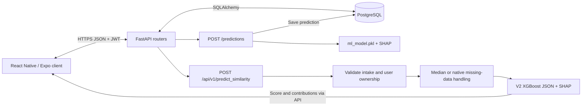

# ADChronotype API

Python FastAPI backend for authentication, research similarity scores, sleep logs and caregiver workflows. PostgreSQL stores application records through SQLAlchemy. Scores are research outputs, not clinical diagnoses.

## Architecture



The model executes inside the backend process. Caregiver recommendations use separate application logic; they are not outputs of the similarity model.

| Flow | Status |
| --- | --- |
| `/predictions` | Existing 20-feature model, normalization/legacy offsets and persisted history; used by the current frontend. |
| `/api/v1/predict_similarity` | Seven-feature V2 endpoint; requires its own JSON model. Inference only, no history persistence. Frontend integration and model-version reporting remain pending. |

Do not substitute the legacy artifact for V2. Training metrics, supplied cohort medians and deployment latency require independent verification. See [V2 integration details](docs/similarity-v2.md).

## Run locally

Use Python 3.11 (matching `runtime.txt`), PostgreSQL and a virtual environment. Run commands from this repository root.

```bash
python3.11 -m venv .venv
source .venv/bin/activate
python -m pip install -r requirements-dev.txt
cp .env.example .env
python -c "import secrets; print(secrets.token_urlsafe(48))"
```

Paste the generated value into `JWT_SECRET_KEY` in `.env`. Set `DATABASE_URL` to your development database. Optional Docker setup, using the local credentials in the example:

```bash
docker run --name adc-postgres -e POSTGRES_USER=adc -e POSTGRES_PASSWORD=adc_local -e POSTGRES_DB=adchronotype -p 5432:5432 -d postgres:16
```

For an existing container use `docker start adc-postgres`. Keep development credentials local.

```bash
alembic upgrade head
uvicorn app.main:app --reload --host 0.0.0.0 --port 8000
```

Open http://localhost:8000/docs for development Swagger UI. Register/login through `/auth`, then use the access token in Swagger's Authorize control. `/health` checks API/database connectivity, not model inference. The existing `ml_model.pkl` must be present for application import. On macOS, XGBoost may require the OpenMP runtime (`brew install libomp`).

## V2 configuration

Place `adchronotype_xgboost_v2.json` in the repository root or set `SIMILARITY_MODEL_PATH` in `.env` or the process environment. Restart the API after changing the file or configuration. It is loaded on the first V2 request and cached after successful loading. Missing or incompatible artifacts return HTTP 503; they do not replace the legacy model.

The artifact must have the named features in this order:

```text
chronotype, sleep_duration, sleep_variability, bmi, family_history, dwell_time, key_latency
```

Example body for the authenticated V2 endpoint (replace the UUID with your signed-in user ID):

```json
{
  "patient_id": "00000000-0000-0000-0000-000000000000",
  "chronotype_score": 50,
  "sleep_duration_hours": 8,
  "bedtime_consistency_std": 1,
  "bmi": 22,
  "family_history": 0,
  "dwell_times_ms": null,
  "flight_times_ms": null,
  "imputation_strategy": "median"
}
```

Caregiver patient IDs are not supported here. Missing or fewer than three samples trigger handling independently for dwell and flight. `native` passes NaN; `median` uses the supplied provisional cohort medians. SHAP explains the raw output, which can differ from the clipped display score.

## Configuration

Required: `DATABASE_URL`, `JWT_SECRET_KEY`. See [.env.example](.env.example) for local values.

- `APP_ENV=production` disables Swagger/ReDoc.
- `FRONTEND_ORIGINS`: comma-separated browser origins; use your frontend's actual port/domain.
- `FRONTEND_APP_URL`: frontend URL for password-reset links.
- `GOOGLE_WEB_CLIENT_ID`: Google authentication audience.
- `RESEND_API_KEY`, `PASSWORD_RESET_FROM_EMAIL`: password-reset email delivery.
- `RUN_MIGRATIONS_ON_STARTUP`: defaults to false; Railway already migrates before starting.
- `ACCESS_TOKEN_EXPIRE_MINUTES`, `REFRESH_TOKEN_EXPIRE_DAYS`: default 60 and 30.

## Code map

- `app/main.py`: application setup, router registration, CORS and startup checks.
- `app/routers/`: HTTP routes and authorization.
- `app/services/`: inference and caregiver recommendation logic.
- `app/schemas.py`, `app/models.py`: API schemas and database models.
- `app/core/`: settings, authentication and dependencies.
- `migrations/`: Alembic database changes.
- `tests/`: API and service tests.

## Tests

Run against a dedicated test database, never production. The focused V2 tests can use a temporary file-backed SQLite configuration; no model artifact is needed for the mocked inference checks.

```bash
DATABASE_URL=sqlite:////tmp/adc-v2-tests.db JWT_SECRET_KEY=local-test-only-not-production python -m pytest tests/test_similarity_v2.py -q
```

Run the broader suite with its test dependencies and a dedicated database configured:

```bash
python -m pytest -q
```

Unit tests do not establish V2 model accuracy or successful deployed inference. Before rollout, test a real authenticated prediction with the correct artifact.

## Railway

Connect the repository and PostgreSQL service; set the environment variables above with production values. `railway.json` runs `alembic upgrade head` then Uvicorn on Railway's `PORT`. Deployments require the correct model artifacts. Check `/health` and exercise authenticated prediction separately.

## License

See [LICENSE](LICENSE).
